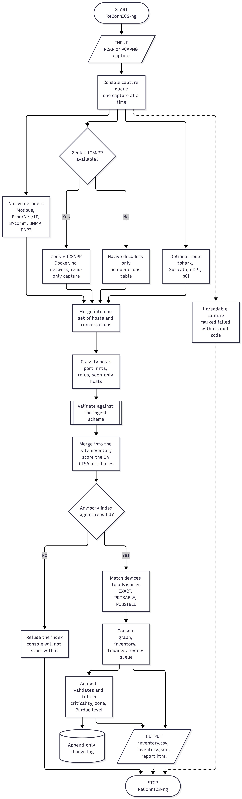

# ReConnICS-ng

<p align="center">
  
  
  
  
</p>

## Overview

ReConnICS-ng is a passive OT asset inventory and network map built from packet captures. It is for security professionals who need to know what is on an industrial network without sending a single packet to it.

- **What it does:** reads a `.pcap`, decodes the industrial protocols in it with Zeek and the CISA ICSNPP parsers (plus a built-in decoder as a cross-check), and builds an inventory of every host with the evidence behind each attribute.
- **Where it sits:** offline, on an analyst machine or a SPAN-port collection box. It listens on `127.0.0.1` only and never contacts the plant network.
- **What it adds:** each device is matched against a signed, offline copy of CISA's CSAF ICS advisories and the KEV list, so "this PLC is probably affected by this advisory" comes with the match level and the reason.
- **What it is not:** a scanner. Results are passive observations and can be incomplete or spoofed. Nothing in the tool is AI: parsing and lookup tables only.

## Workflow



1. A capture is uploaded in the console (or sent with `analyze --post`) and queued. Captures run one at a time.
2. The built-in decoders and, when available, Zeek with the ICSNPP parsers read the same file. A missing optional tool is shown as "not installed", never as an error.
3. Both results are merged into one set of hosts and conversations. Hosts that were only pinged or only sent a SYN are kept as "seen only", not dropped.
4. The result is validated against the ingest schema and merged into the site inventory, which scores each device against the 14 CISA asset attributes.
5. Devices are matched against the signed advisory index. An index whose signature does not verify is refused.
6. The analyst reviews the graph, validates records and exports. Every edit is written to the change log.

## Key Features

1. **Passive only.** No packets are sent. The capture is read and nothing else.
2. **Zeek + CISA ICSNPP.** Modbus, DNP3, EtherNet/IP and S7comm detail: function codes, addresses, values.
3. **Evidence for every field.** Each attribute carries a confidence level and the frame or log it came from.
4. **Offline advisory matching.** A signed index of CISA CSAF OT advisories and KEV, carried across the air gap.
5. **Asset graph.** Conversations as directed edges, start-to-target path finding, filters by level, protocol, KEV and capture.
6. **Nothing is silently dropped.** Low-value hosts and flows are classified and can be hidden in the view, never deleted.
7. **Export.** `inventory.csv`, `inventory.json` and `report.html` from the Export screen.

## Demo

Demo video: _link added with the Black Hat Arsenal submission_.

## System requirements

- **OS:** Linux (Ubuntu/Debian tested) or Windows 10/11. macOS is not a target.
- **Software:** JDK 21+, Maven 3.9+, Docker (Docker Desktop on Windows). Docker runs Zeek and the other engines.
- **Memory:** 8 GB RAM recommended.
- **Disk:** about 10 GB free. The two images are about 1.8 GB; each capture also writes logs of up to several times its own size (the console shows the Zeek + ICSNPP log size per capture under Details, and in the run log; they are deleted after the run).
- **Network:** no network interface is needed to analyze a capture. Internet is only needed once, to install.

## Installation

### Linux

```bash
curl -fsSL https://raw.githubusercontent.com/Skoelle18/ReConnICS-ng/main/install.sh | bash
```

### Windows (PowerShell)

```powershell
irm https://raw.githubusercontent.com/Skoelle18/ReConnICS-ng/main/install.ps1 | iex
```

The command clones the repo into `./ReConnICS-ng` (or inside an existing clone you can run `./install.sh` / `.\install.ps1` directly). It first checks git, Java 21+, Maven, Docker running, free disk (about 8 GB), github.com and port 8088, and lists everything that is missing at once. It then builds the jar and the two Docker images, downloads and verifies the signed advisory index, then starts the console. Pass `--no-start` (`-NoStart` on Windows) to install without starting it: `curl … | bash -s -- --no-start`.

## Usage

1. Open <http://127.0.0.1:8088/>.
2. Click **Upload PCAP** and drop in one or more `.pcap` / `.pcapng` files. A running capture shows its seven steps as a progress bar with the analysis log underneath, live.
3. When a capture shows `done`, use the graph, Inventory, Findings and Export screens.

To start the console again later:

```bash
java -jar target/reconnics-ng.jar serve --index data/index.json --pubkey keys/index-signing.pub --data data/site
```

### Frequently used flags

- `--index` points at the signed advisory **data file** (`data/index.json`).
- `--data` (default `data/site`) is the console's working directory: uploaded PCAPs, analyzer output, analyst edits and the append-only change log persist there across restarts. 

Refer to the documentation in [`docs/Site-console.md`](docs/Site-console.md) for more information about them.
## Project Structure

```
ReConnICS-ng/
├── install.sh / install.ps1   one-step install and start
├── src/main/java/             analyzer, advisory matcher, console server
├── src/main/resources/ui/     the console (plain HTML, CSS, JS)
├── docker/                    Zeek + ICSNPP image, tools image (tshark, Suricata, nDPI, p0f)
├── data/                      advisory index and site data (not committed)
├── keys/                      public key that verifies the advisory index
├── eval/                      how detection and identity are measured
└── docs/                      the wiki: all technical documentation
```

## Documentation

Everything technical (command line, Zeek setup, engines, ingest API, advisory index, troubleshooting) is in the [wiki](https://github.com/Skoelle18/ReConnICS-ng/wiki) (source: [`docs/Home.md`](docs/Home.md)).

## Credits

Built on [Zeek](https://zeek.org) and the CISA [ICSNPP](https://github.com/cisagov/icsnpp) analyzers (BSD-3-Clause),
[Wireshark](https://www.wireshark.org) (GPL-2.0-or-later), [Suricata](https://suricata.io) (GPL-2.0), [nDPI](https://github.com/ntop/nDPI)
(LGPL-3.0), [p0f](https://lcamtuf.coredump.cx/p0f3/) (LGPL-2.1), data files of [Nmap](https://nmap.org) (Nmap Public Source License)
and the IEEE OUI registry. The idea of a GUI over existing network tools follows
[GRASSMARLIN](https://github.com/nsacyber/GRASSMARLIN). No code of any of them is copied into this repository. Licences: [`NOTICE`](NOTICE).

### Dataset Attribution

**4SICS Geek Lounge ICS/SCADA PCAP Dataset**

Evaluation of ReConnICS-ng uses publicly available network captures from the 4SICS Geek Lounge ICS/SCADA dataset, published by [Netresec](https://www.netresec.com/?page=PCAP4SICS). The dataset originates from the 4SICS event organised by CS3Sthlm. We acknowledge Netresec and CS3Sthlm as the original source and organisers.

The [4SICS-GeekLounge-151022 processing log](eval/logs/4SICS-GeekLounge-151022-20261027.txt) records the capture run and its engine results.

The associated [4SICS inventory report](eval/reports/4SICS-GeekLounge-151022-inventory-report.html) contains the generated asset inventory and advisory matches.

## License

See [`LICENSE`](LICENSE).

## About - Arsenal FOSS Project

Operational technology (OT) is the hardware and software that directly monitors, controls and automates physical processes and infrastructure in industrial settings. We are building a FOSS alternative for the asset inventory systems that OT platforms already use.
