# Console tour

Screenshots of the site console (`java -jar target/reconnics-ng.jar serve ...`, then `http://127.0.0.1:8088/`), taken from a running instance with three captures merged: `MicroLogix56.pcap`, `IEEE_802.1ag-CFM-CCM.pcap` and `4SICS-GeekLounge-151022.pcap`. The console only listens on 127.0.0.1 and nothing it shows is sent anywhere.

Every screen has its own address (`#/graph`, `#/overview`, `#/captures`, `#/review`, `#/advisories`, `#/index`, `#/ethernet`, `#/engines`, `#/log`), so a link to a screen can be shared inside the team.

## 1. The asset graph (`#/graph`)

The home screen. Nodes are hosts, edges are conversations between a host pair.

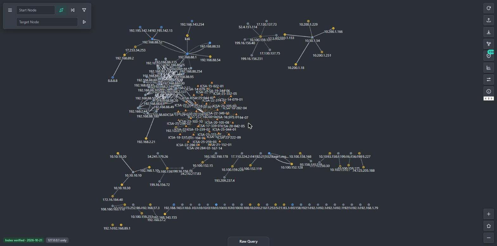

- The top-left card holds the menu, the pathfinding boxes and the filter button.
- The right-hand rail holds refresh, import, export, re-run layout, review queue (with its count), overview, settings and the legend.
- The bottom-left badge shows that the signed advisory index verified; `127.0.0.1 only` shows the console is local.
- Orange triangles are advisories (ICSA ids). They are drawn as nodes so you can see which hosts they attach to.

The menu lists all nine screens, with counts for the review queue (114) and advisories (91):

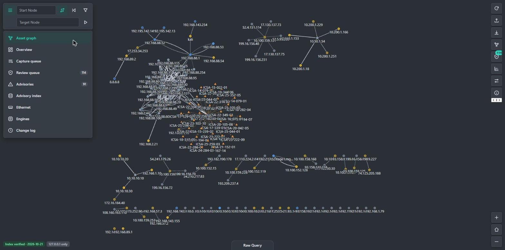

### Legend

Node colour is the role; edge colour is the protocol. The legend also explains the rings, badges and arrows.

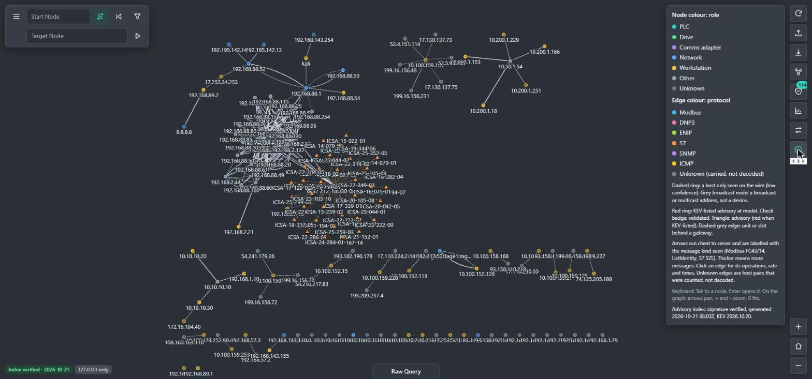

- Dashed ring: a host only seen on the wire (low confidence). Grey node: a broadcast or multicast address, not a device.
- Red ring: a KEV-listed advisory at that model. Triangle: an advisory.
- Arrows run client to server and are labelled with the message kind seen (Modbus FC43/14, ListIdentity, S7 SZL). Thicker means more messages.
- Unknown edges are host pairs that were counted, not decoded.

### Filters and display options

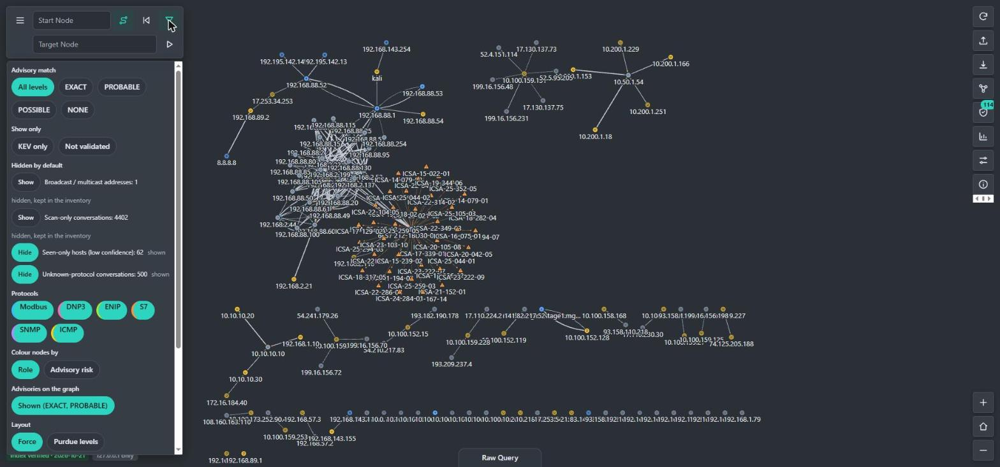

- Advisory match level (EXACT, PROBABLE, POSSIBLE, NONE), KEV only, Not validated.
- Hidden by default: broadcast/multicast addresses, scan-only conversations, seen-only hosts, unknown-protocol conversations. Each shows its count and can be turned on. Nothing here is deleted; it is kept in the inventory and only hidden from the picture.
- Protocol chips, colour by role or advisory risk, force or Purdue layout, and a chip per capture.

With the hidden items shown, `255.255.255.255` and the scan-only hosts appear:

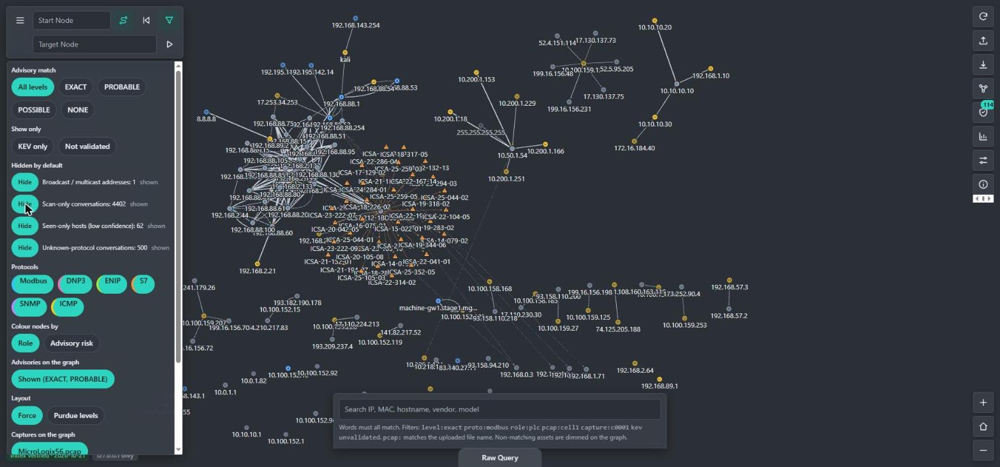

### Raw Query

The search box at the bottom filters the graph and dims everything that does not match. It takes words (IP, MAC, hostname, vendor, model) and filters such as `level:exact`, `proto:modbus`, `role:plc`, `pcap:cell1`, `capture:c0001`, `kev` and `unvalidated`.

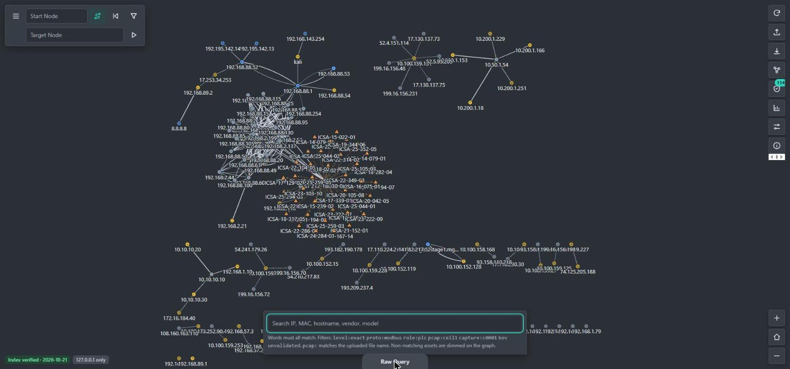

`pcap:MicroLogix` keeps only the hosts seen in that capture:

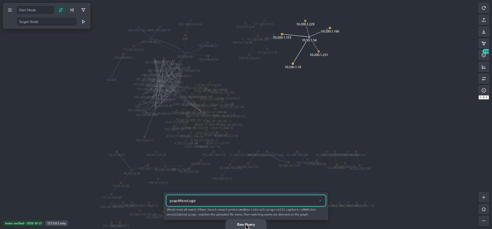

### Pathfinding

Type a start and a target and press the play button. The shortest conversation path is highlighted and the rest is dimmed. Here, `10.200.1.18` to `10.200.1.251` is two hops through `10.50.1.54`, and each edge is labelled with what was seen.

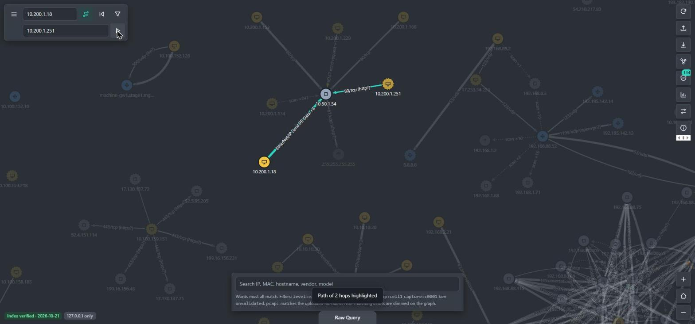

## 2. Looking at one host (`#/asset/<ip>`)

Click a node. The panel shows the identity, where it was seen, how complete the record is, and the next step that would raise the match.

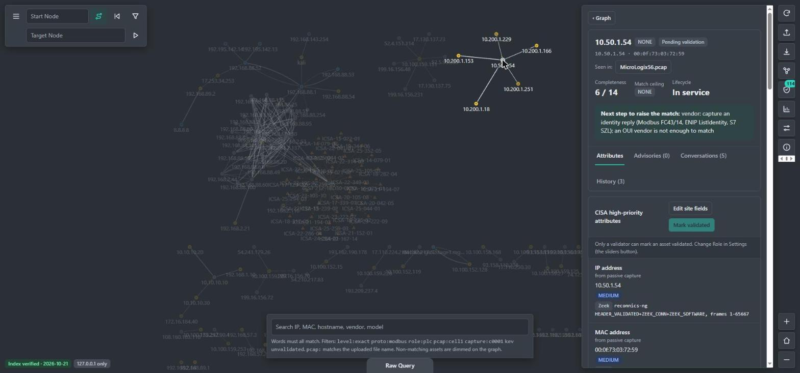

- Completeness (6 / 14) counts how many of the CISA high-priority attributes are filled in.
- Match ceiling is the best advisory level the evidence allows. "An OUI vendor is not enough to match" is why a host with only a MAC vendor stays at NONE.
- Each attribute carries a confidence badge, the tool that produced it, and the evidence (`HEADER_VALIDATED+ZEEK_CONN+ZEEK_SOFTWARE`) with the frame range.

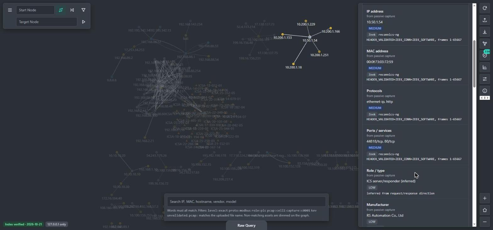

**Edit site fields** and **Mark validated** are for the plant side; only a validator role can validate.

### Advisories

A host with a vendor match lists every advisory that could apply, with CVEs and the affected versions. "Vendor only; every advisory for this vendor is listed" is the POSSIBLE level: the model is not known yet.

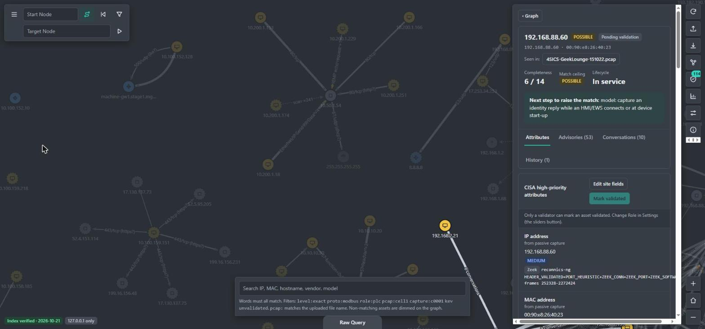

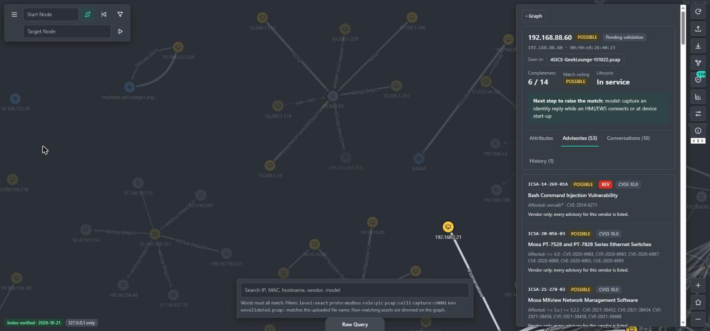

### Conversations

Every conversation the host took part in, with the other end, the protocol and port, the message count, and the message kinds. `Details` opens the edge.

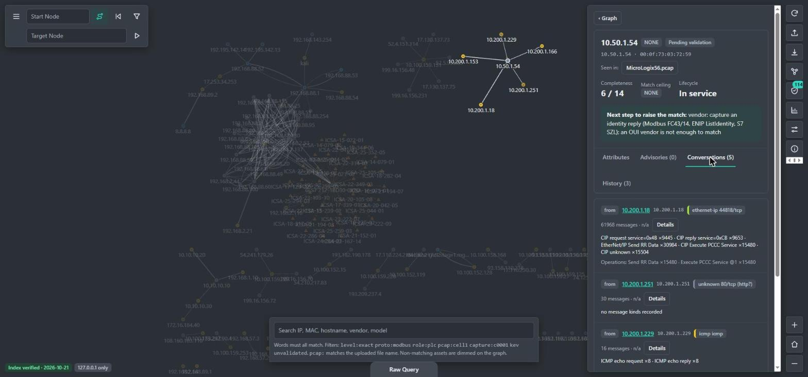

### History

The change log filtered to this host: when it first appeared and which captures did not see it again.

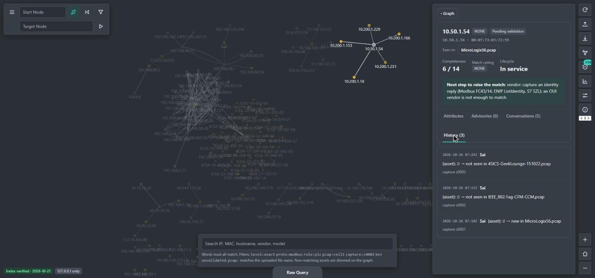

## 3. Looking at one conversation (`#/edge/...`)

An EtherNet/IP edge decoded by Zeek and the native decoder: messages, packets, the message kinds, and the operations table (function, access, address, quantity, count, outcome).

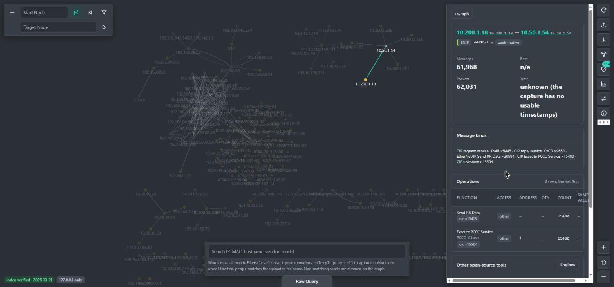

Below it, **Other open-source tools** lists what Suricata, nDPI and p0f said about the same conversation, each with the tool, its version, and a plain-language reading. The community ID can be searched in Suricata, Zeek or Wireshark to find the same flow there.

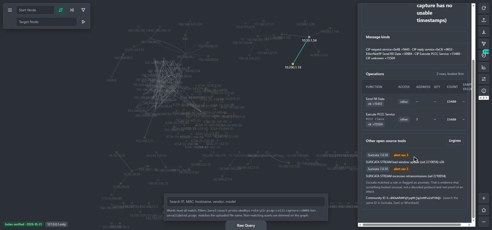

A conversation that is carried but not decoded is still listed. `10.200.1.251` sends 30 packets to port 80 of the PLC without completing a handshake, so the panel says what is known (host pair and port), what is only a hint (`port-inferred: http?`), and that no operation detail exists.

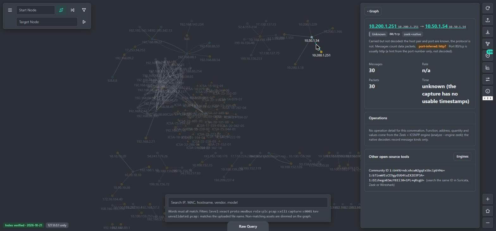

### Broadcast and multicast

A group address is never an asset and never matched to an advisory. It gets a panel of its own: packets, bytes, ports, protocols, and who sent to it.

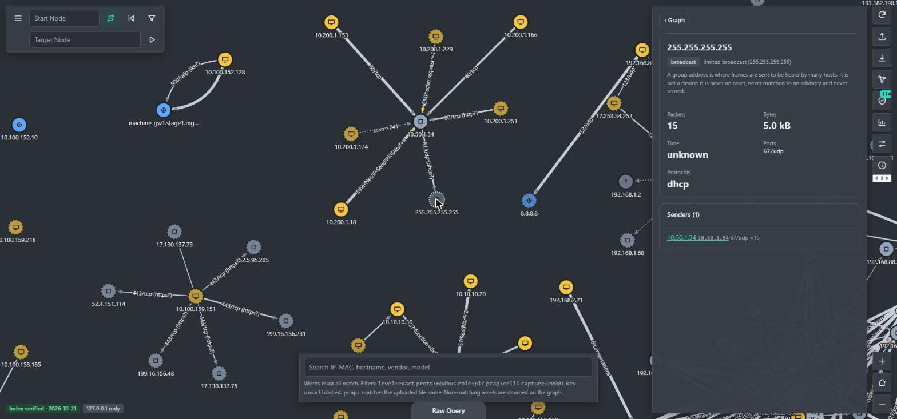

## 4. Site overview (`#/overview`)

The Purdue model view places every host by level from its role (suggested; set per asset), with an advisory match bar and a role breakdown. **Export report** writes the report; **Queue PCAPs** goes to the capture queue.

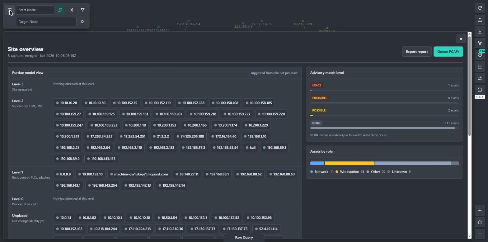

## 5. Capture queue (`#/captures`)

Captures run one at a time and merge into the site inventory. Each row shows the file, size, time, who queued it, the result (`+107 new · 0 changed · 7 not seen`) and the SHA-256. The same file twice is refused. **Remove assets** takes out what only that capture added, **Hide** hides the capture, and **Details** shows the run.

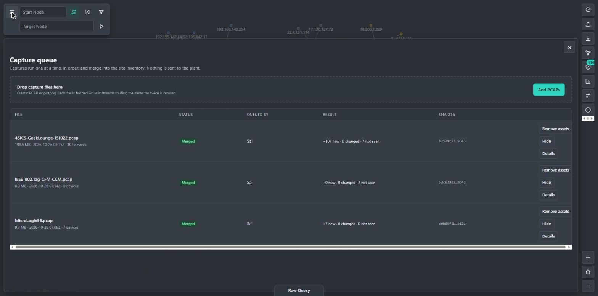

## 6. Review queue (`#/review`)

Hosts whose role, vendor or model rests on weak evidence, for the plant engineer to confirm. This follows the CISA guidance to cross-check collected data before an owner validates it.

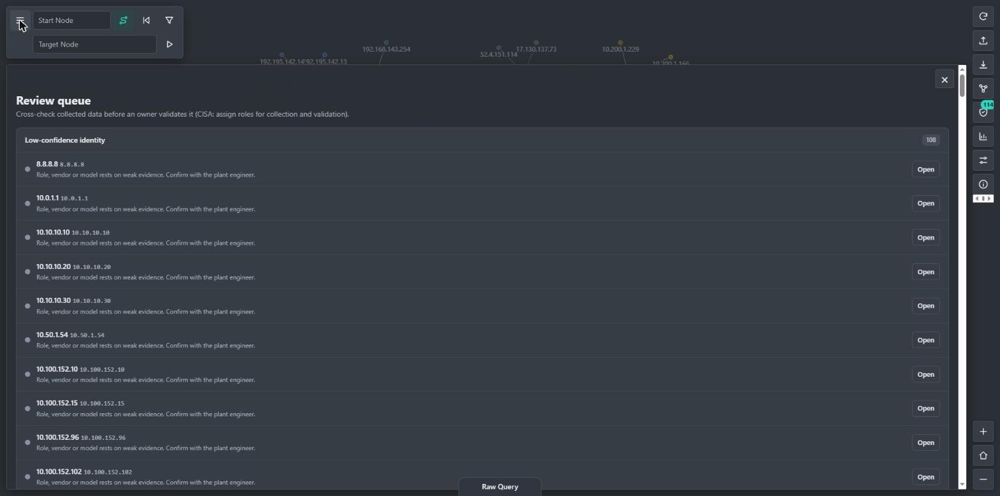

## 7. Advisories (`#/advisories`)

The CISA CSAF advisories that hit at least one asset, KEV-listed first, then by CVSS.

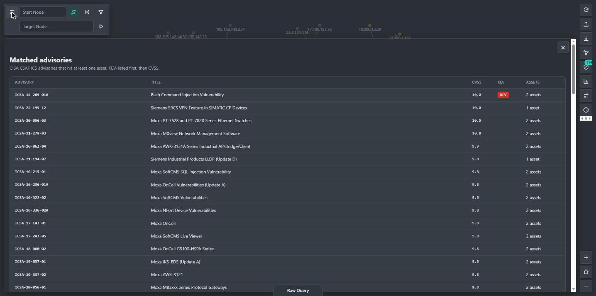

A row opens to the CVEs, the affected versions and the matching hosts with their match level.

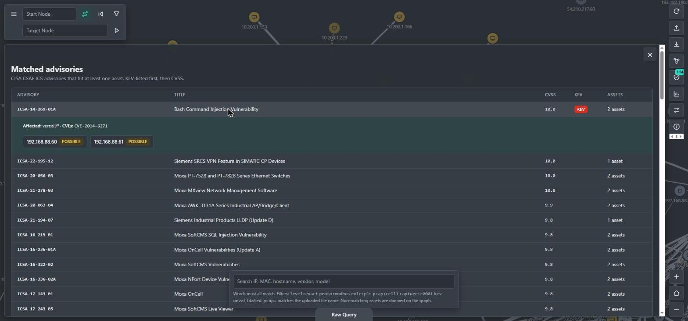

## 8. Advisory index (`#/index`)

The signed index built on the online side from CISA CSAF OT and KEV and carried across the air gap. It shows when it was generated, the KEV catalogue date, the advisory and row counts, and the signature result (Ed25519 verified). A new index is verified first; a bad signature is refused and nothing changes until you activate it.

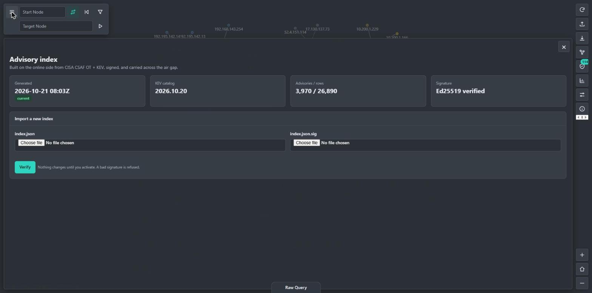

## 9. Ethernet (`#/ethernet`)

Per source MAC: the vendor of the network card, frames sent and received, and the IP addresses seen behind it. A MAC with several IPs is often a router, firewall or NAT interface. Every such note is labelled as inferred, not observed.

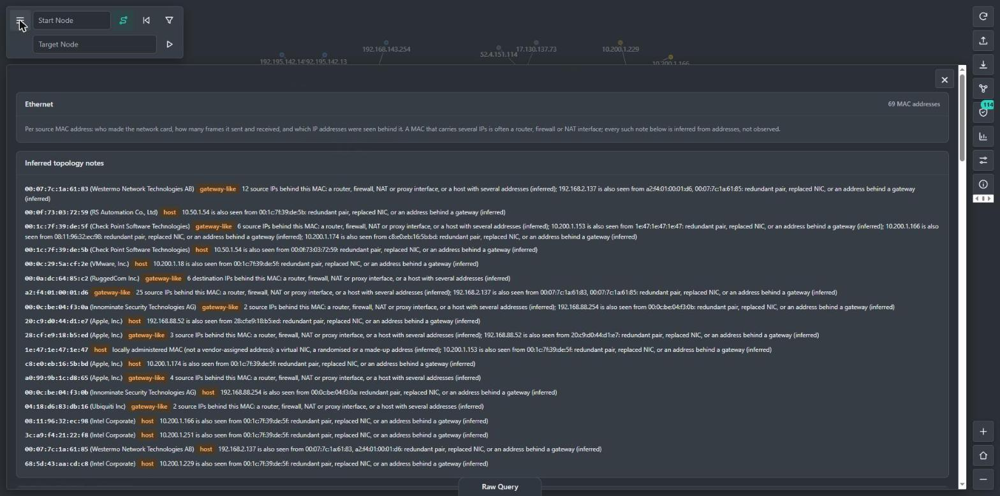

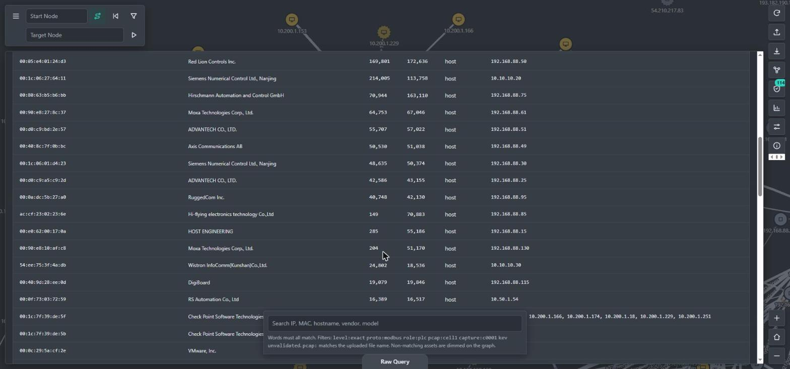

## 10. Engines (`#/engines`)

Every open-source tool the console wraps, whether it is installed on this machine, how many captures used it, its licence and what it does for ReConnICS. Zeek with the ICSNPP packages is the primary engine; the rest are optional and used only when found.

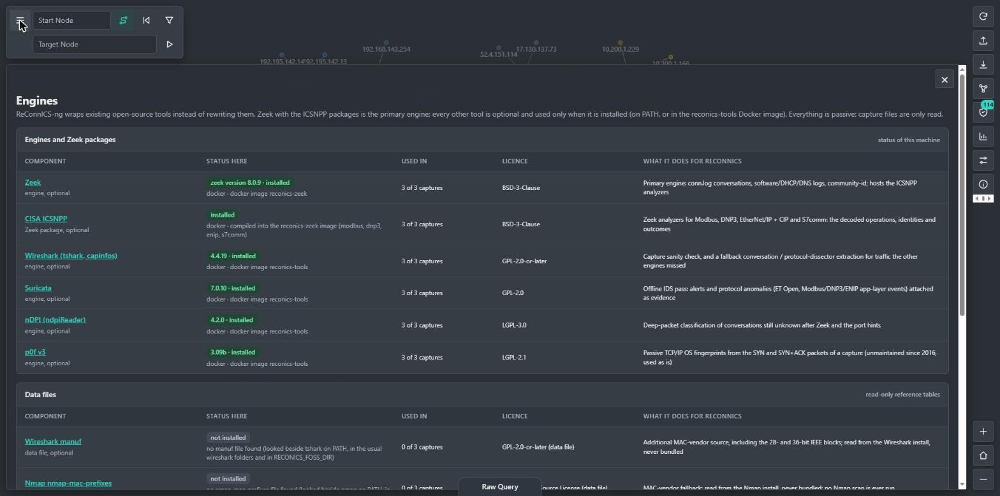

Data files and lineage. The Wireshark `manuf` and Nmap files show **not installed** on this machine; the IEEE OUI table is bundled in the jar. GRASSMARLIN, Malcolm and Arkime are listed as lineage only: not run, not bundled.

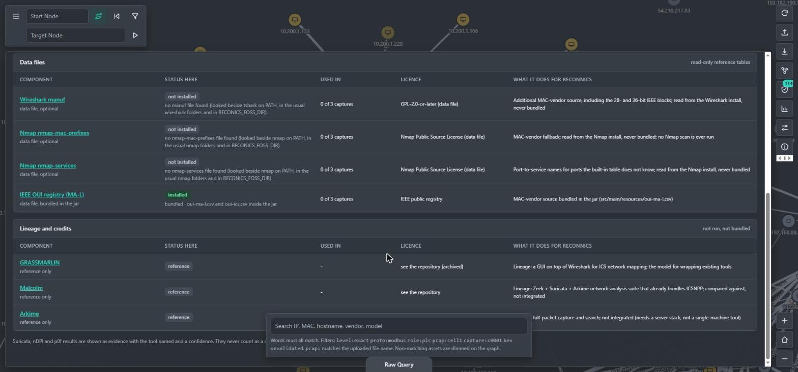

For the full per-tool notes see [foss-components.md](foss-components.md).

## 11. Change log (`#/log`)

Append-only: every capture merge, human edit and index swap, newest first, with who, which asset, which field, the change and the source capture.

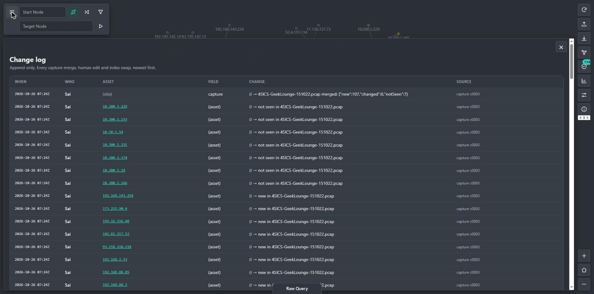

## 12. Settings

Your name and role. Edits are logged under this name. There is no login because the console only listens on 127.0.0.1.

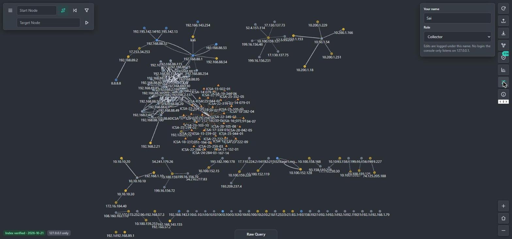

## Not covered here

- Import (upload) and export were not clicked, so no file was added or written.
- Edit site fields and Mark validated were not used, so the change log stays as the captures left it.
- The Purdue levels layout chip was switched on, but the picture did not clearly separate into levels, so it is left out until that is checked.
