# Console screenshot tour

This tour uses the 18 screenshots supplied in `ReConnICS-ng UI Screenshots/` and copied to `docs/ui-tour/`. The supplied images are dated 2026-10-31. They show the ReConnICS-ng console, including its graph and inventory, capture processing, advisory views, and asset/edge detail panels.

Screenshots are visual references to the UI state shown in each image. A screenshot does not by itself establish the provenance or accuracy of the underlying capture data, a successful application restart, or passive operation on a live network.

## Graph and inventory

The graph shows discovered hosts, conversations, protocol filters, and selected-object details.

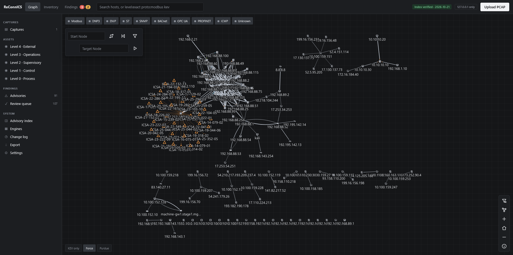

The inventory view lists known assets and their available identity and protocol information.

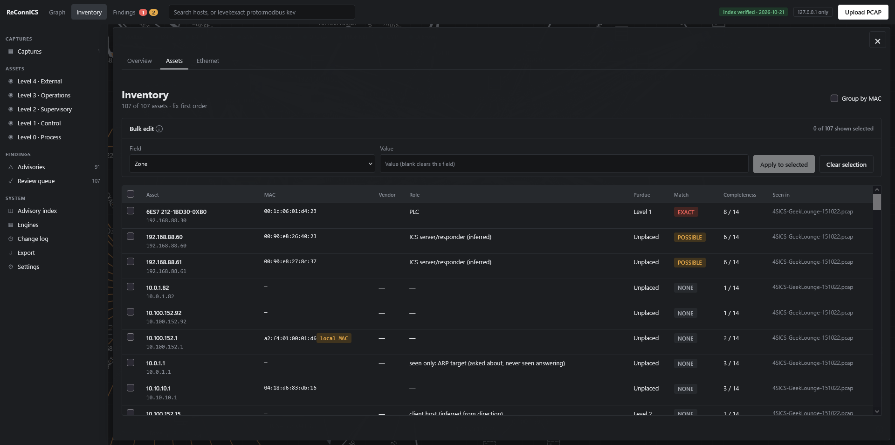

The overview presents assets by suggested Purdue level, alongside the role and advisory summaries.

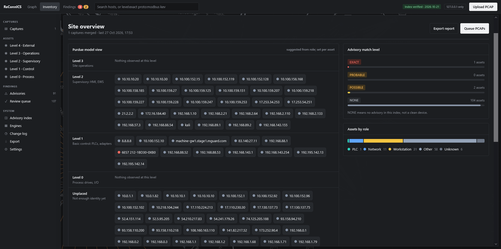

## Capture processing

The capture queue lists captures, their status, run results, and available details.

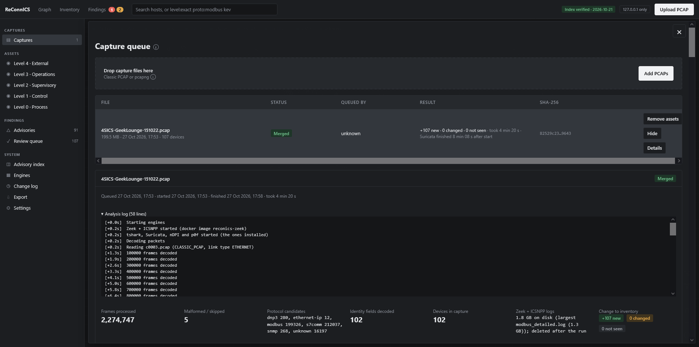

The capture details view shows the selected run and its visible processing log and summary.

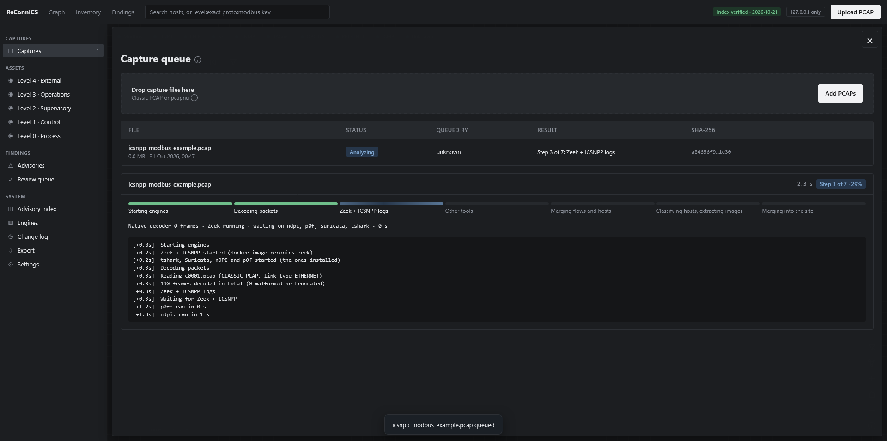

The console also has an export screen for inventory/report outputs.

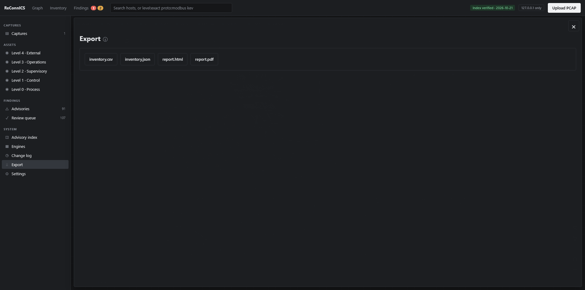

## Findings and review

The advisories screen lists advisory matches with their severity and affected asset information.

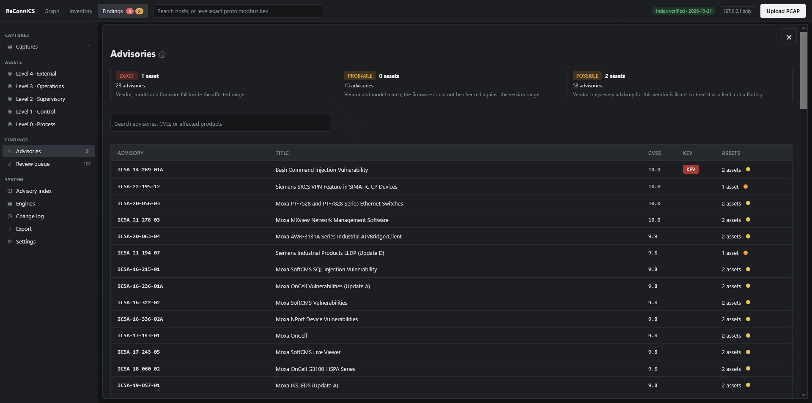

An expanded advisory shows affected product/version information and related assets.

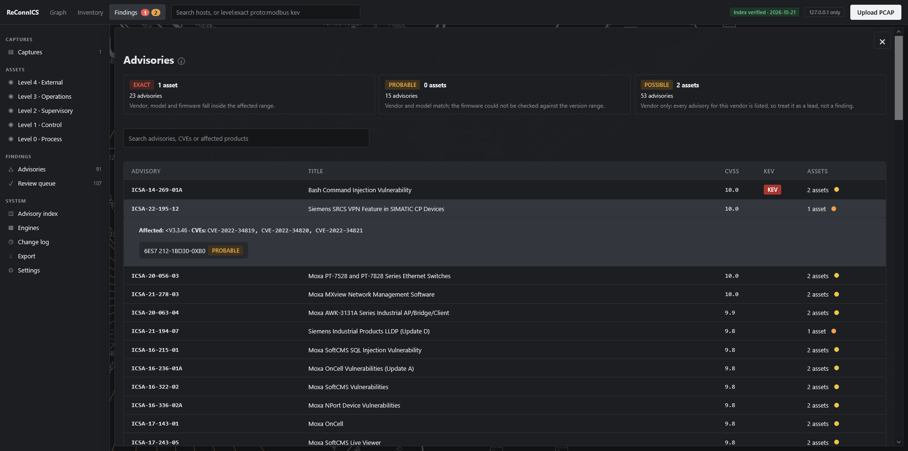

The asset's advisory tab shows advisory matches associated with that asset.

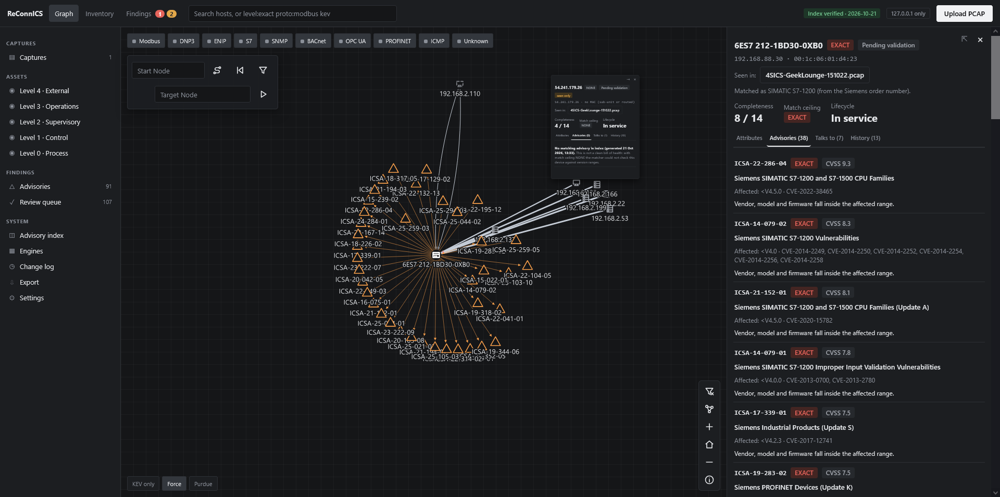

The review queue lists assets awaiting analyst or operator review.

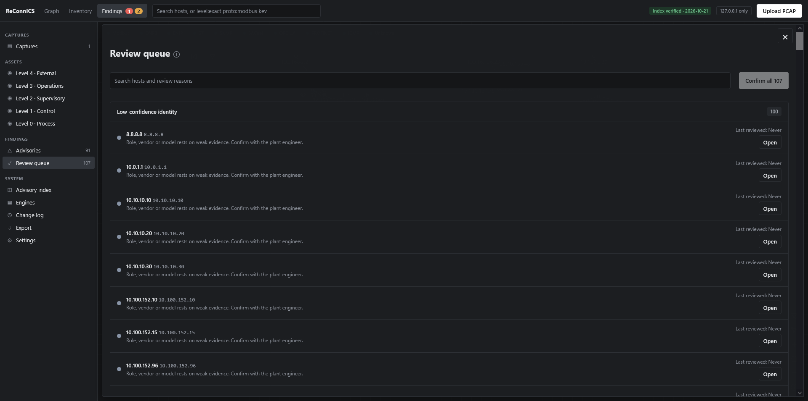

The advisory index screen displays index status and index management controls.

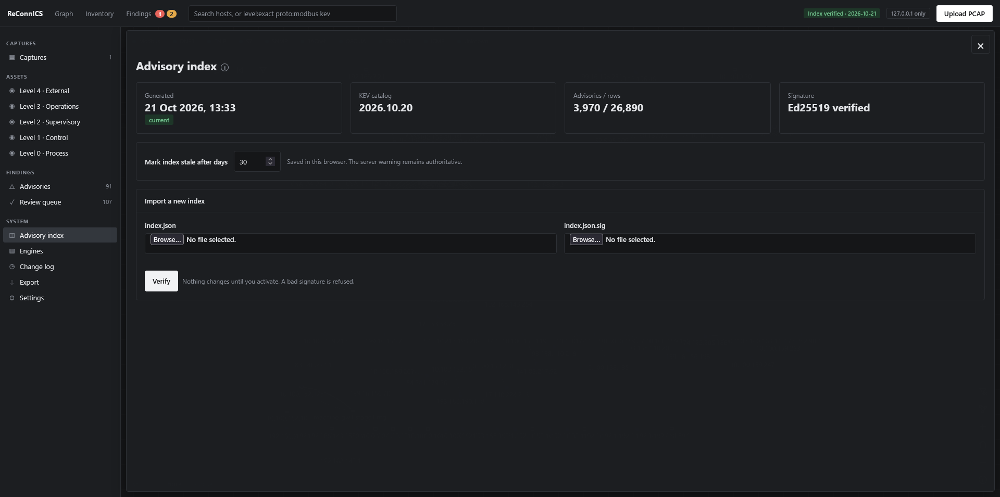

## Asset and conversation details

The asset panel shows identity attributes, confidence/evidence labels, and validation status.

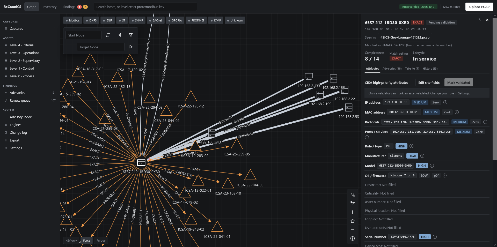

The asset conversations tab lists other hosts and observed protocol conversations.

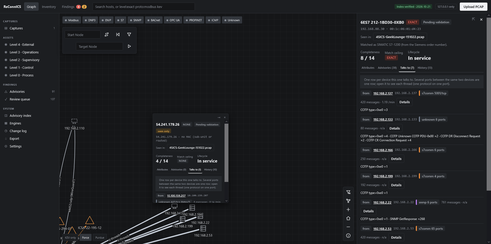

The edge summary shows aggregated communication details between two endpoints.

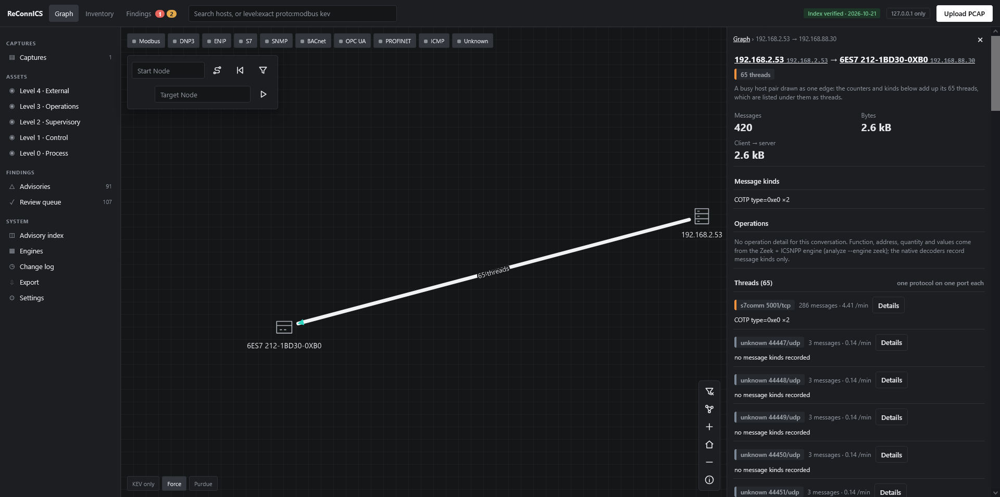

The expanded edge conversation view shows individual conversation details and observed messages.

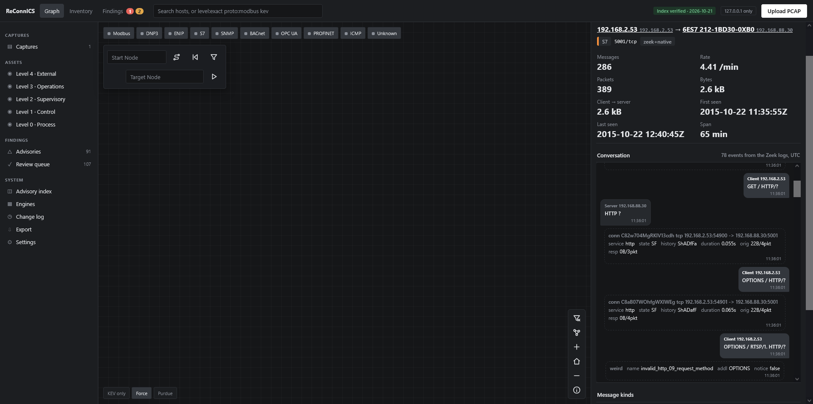

## System screens

The Engines screen lists available analysis tools and their states.

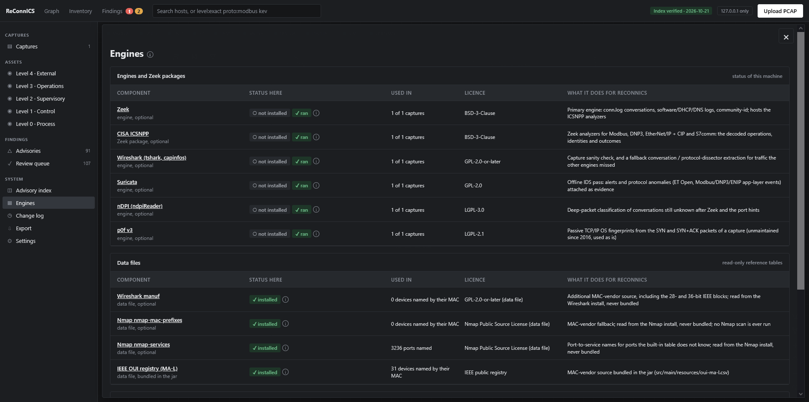

The change log displays recorded site and inventory changes.

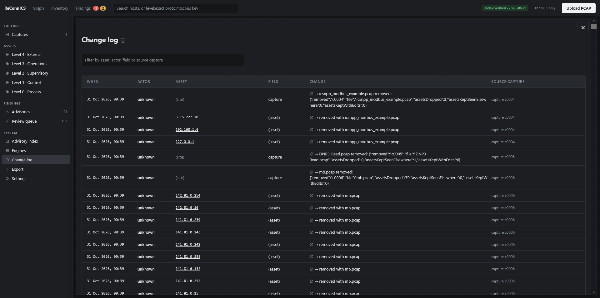

Settings contains local console preferences and user/role controls.

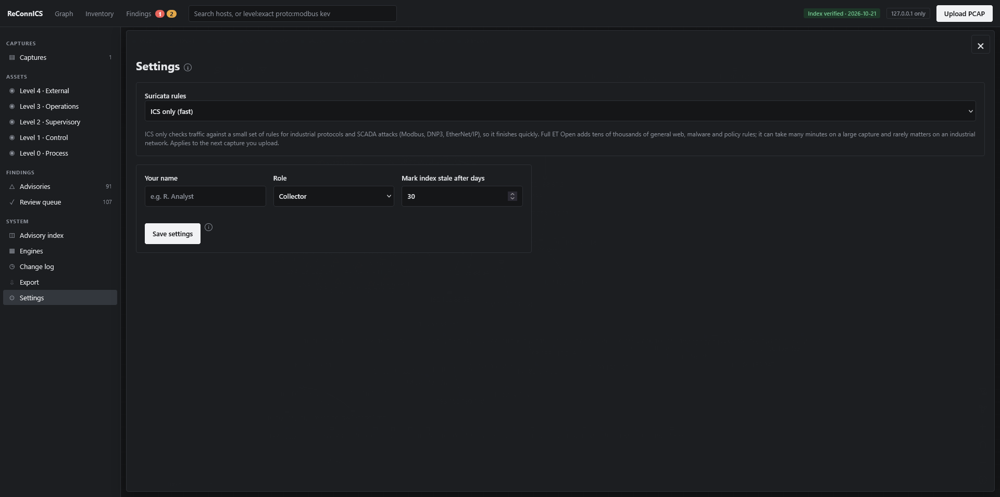
